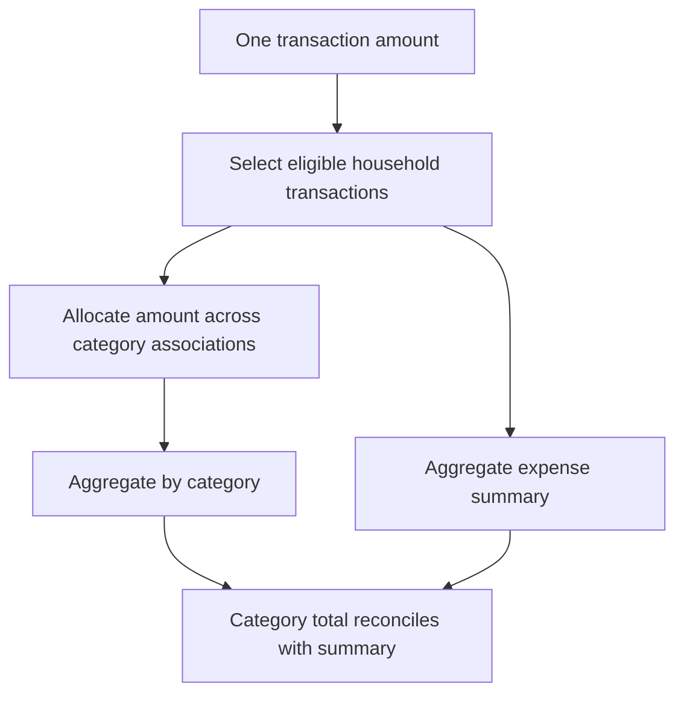

# Why the Category Chart Had More Money Than the Transactions

[NeuroSpend](https://neurospend.vercel.app) is my personal expense manager. It ingests Axis, SBI, and HDFC statements, categorizes transactions, and shows a household dashboard. The backend is Go with Gin and pgx on PostgreSQL.

Expense dashboards have a property most dashboards don't: their numbers have to reconcile. If the category chart and the spending summary cover the same period, they're describing the same money, and they should agree to the rupee.

Mine didn't. Fixing it meant going through the whole backend, because the bug wasn't in any single query. Transactions could have more than one category. Transfers showed up in statements but aren't spending. Investment accounts aren't household spending accounts. The database stored debits as positive, while the UI wanted income and spending as separate positive numbers. Each of those was easy to handle alone. Handling them separately in independently written queries is how a dashboard ends up disagreeing with itself.

## The join changed what was being summed

Take one ₹1,000 debit tagged with two categories:

| Transaction | Category | Original amount |
| --- | --- | ---: |
| T1 | Groceries | ₹1,000 |
| T1 | Household supplies | ₹1,000 |

The association table correctly has two rows. Sum the transaction amount after the join and you get ₹2,000. `DISTINCT` on the whole row doesn't help, because the categories differ. `SUM(DISTINCT amount)` is worse: two unrelated transactions that happen to cost the same get merged.

The real mistake is the grain. Before the join, an amount belongs to a transaction. After the join, each row is a transaction–category pair. The amount has to be allocated at that new grain before anything gets summed.



## Write the conservation rule down

For a categorized expense, the category allocations have to add up to the transaction amount. If partial allocation is allowed, the leftover needs a home too:

```text
sum(category allocations) + unallocated remainder = transaction amount
```

An equal split puts ₹500 in each category. User-defined split amounts would be used instead if the product supported them. The allocation policy can vary. Copying the full amount into every category can never satisfy the rule.

Here's the equal-split version, simplified from the real schema:

```sql
WITH allocated AS (
    SELECT
        t.id,
        tc.category_id,
        t.amount::numeric
            / COUNT(*) OVER (PARTITION BY t.id) AS category_amount
    FROM eligible_transactions t
    JOIN transaction_categories tc ON tc.transaction_id = t.id
)
SELECT category_id, SUM(category_amount)
FROM allocated
GROUP BY category_id;
```

This assumes every transaction included has at least one unique category. Uncategorized ones need their own bucket or a left join. Money also needs one explicit rounding rule in minor units. Rounding every fragment separately and hoping the total survives doesn't work.

## Fix the scope before comparing totals

Even perfectly additive category numbers won't match a summary that selected different transactions.

So I moved household eligibility into the repository layer, in one place, and reused it for the summary, monthly, and category queries. It excludes deleted transactions, investment-account activity, and transfers between your own accounts.

Transfers show why "debit" and "expense" aren't the same word. Moving ₹10,000 from savings to current produces a debit and a credit in your statements, but you didn't spend anything and you didn't earn anything.

For rejecting transactions that carry a transfer category, `NOT EXISTS` works well. It decides eligibility without multiplying rows the way a join would, and the rule is easy to read in the query.

## Flip signs in exactly one place

Storage stayed debit-positive. The insight summary exposes spending and income as positive numbers, with net flow defined as income minus spending, so the UI can display them without inverting anything again.

Category totals have a different job: they stay signed and additive. A separate expense-only view feeds the spending charts. If I'd mixed those contracts, a refund would vanish from a category just because a chart expected every bar to be positive.

While I was in there, I found and fixed reversed signs in one of the custom credit/debit statement parsers. No aggregation can rescue a transaction whose direction was wrong at ingestion.

## Cash balance is not net worth

There was also an endpoint named after net worth that was really computing a historical cash balance. A cash series should come from cash movements plus an opening balance. Today's investment valuation answers a different question.

I renamed it to say cash balance and kept investment-ledger activity out of that series. A rename isn't a reconciliation, but it stopped the API from promising a number its inputs couldn't produce.

Investment orders need the same care. An internal fund switch creates a redemption and a purchase, and neither one is money entering or leaving the portfolio from a bank. Treating every order as an external cash flow skews returns.

## Small tests, big payoff

The regression cases that mattered were all tiny: one transaction with two categories, two different transactions with the same amount, a transfer, an uncategorized debit, and a refund. Each one catches a mistake that a plausible-looking monthly chart can hide for months.

None of this needed a fancier visualization. The fix was one eligible transaction set, an additive measure at the right grain, and an explicit sign contract at the API boundary. Now the dashboard finally agrees with itself.
