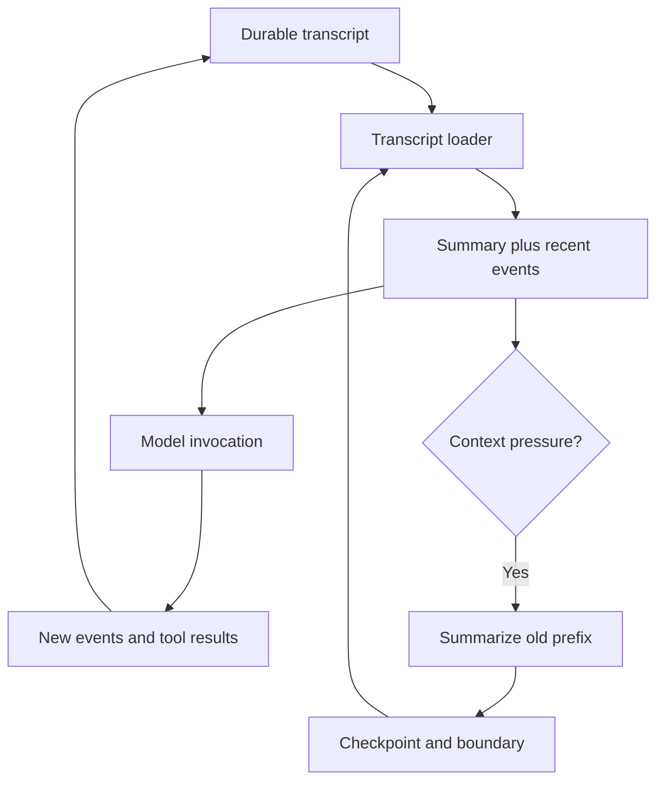

# Compacting an Agent Is Easy. Keeping It Compacted Is Not.

The first version of compaction worked perfectly, for exactly one turn.

The agent hit its context limit, summarized the old history, and the next model call went through. Then the turn ended. The next turn started, the transcript loader read the session from disk, and it loaded the entire original history again. The conversation was oversized again, so it got summarized again. Each new turn paid to compact the same prefix.

A better summary prompt wouldn't have fixed this. The bug was a storage question nobody had answered: **which part of the transcript has this summary replaced?**

After that, I stopped treating compaction as a text transformation. It's a checkpoint in an execution system, and it has to survive the same restarts everything else does.

## There are two histories

A session really has two histories, and they want opposite things.

- **The full trace** is an audit record. It should keep every tool call and result, enough to reconstruct exactly what happened.
- **The active context** is a working set. It can't keep every byte forever.

Truncate the trace to save context and you destroy evidence. Reload the whole trace as context and you undo compaction. So the design keeps both: a compacted checkpoint, plus whatever arrived after it.

```text
active context = checkpoint + events after checkpoint boundary
```

The checkpoint is more than prose. It also records where the boundary sits and the operational state the next turn needs.



The edge that matters is **checkpoint → loader**. My original compactor only rewrote an in-memory message list, so nothing changed for the next worker that loaded the session.

## Shrink tool output before you summarize it

A lot of context pressure doesn't need a model call to fix. A tool returns a huge query result, or a log file that turns out to be one enormous JSON line. Keeping all of it inline spends context on data the agent may never look at again.

So I split the stored result from what goes inline. The full output becomes a retrievable artifact. The context gets a bounded preview and a reference to that artifact. The cap is on bytes as well as lines, because one line can be bigger than the whole preview budget.

Older results can then be swapped for references while recent ones stay inline. That's far cheaper than asking a model to keep re-describing a database dump. It isn't free: it costs storage and the occasional re-read, and a reference is only useful if the agent still has the tool and permission to fetch it.

## Keep what a summary can't infer

A summary can describe the task accurately and still drop the things the next turn depends on: the instructions of a skill the agent invoked, the tools it loaded through discovery, the file it was about to edit.

Those aren't conversation. They're execution dependencies. If you leave them to the summarizer, the next turn works only when the summarizer happened to mention them.

So the retained context has three parts:

| State | Why retain it? |
| --- | --- |
| Task summary | Current objective, decisions, unresolved questions |
| Operational state | Loaded instructions and relevant execution resources |
| Recent events | Exact inputs and outputs near the next action |

The recent suffix also has to keep tool calls paired with their results. If you split a call from its result, the model API can reject the conversation even though the text reads fine.

## Publish the summary and the boundary together

Suppose the compactor has summarized events through number 800. It writes the summary, then crashes before recording 800 as the new boundary. The loader now pairs the new summary with the old boundary and replays those events twice.

The opposite order is worse. If the boundary advances before the summary is durable, you skip history that was never summarized.

The summary and the boundary have to become visible as one unit. In a database, that's a transaction. With file-backed storage, a versioned checkpoint manifest can name the summary artifact and the boundary together, so the loader can tell a published checkpoint from a half-written one. Two plain file writes in a row don't give you that.

## The test that actually catches it

A compaction test that only inspects the current message list would have passed against my broken version. The test I care about goes through a restart:

1. Build a transcript long enough to trigger compaction.
2. Persist a checkpoint and its boundary.
3. Throw away the in-memory context.
4. Load the session through the normal restart path.
5. Confirm the old prefix wasn't replayed and the recent suffix appears exactly once.

Then append another event and reload again. The checkpoint should still hold without summarizing the same prefix a second time.

One more thing I watch now is pressure estimates. A rough character-based estimate is fine as a trigger, but it isn't what the provider bills. I've seen our internal estimate disagree badly with the token counts the provider reported. Comparing the two stops "context is huge" from becoming the explanation for every expensive run.

## What this does and doesn't solve

Compaction still loses detail, and artifact references still cost extra reads. Persistence doesn't fix either of those. What it fixes is narrower and more important: once the system has paid to replace a prefix, the next turn actually starts from that replacement.
