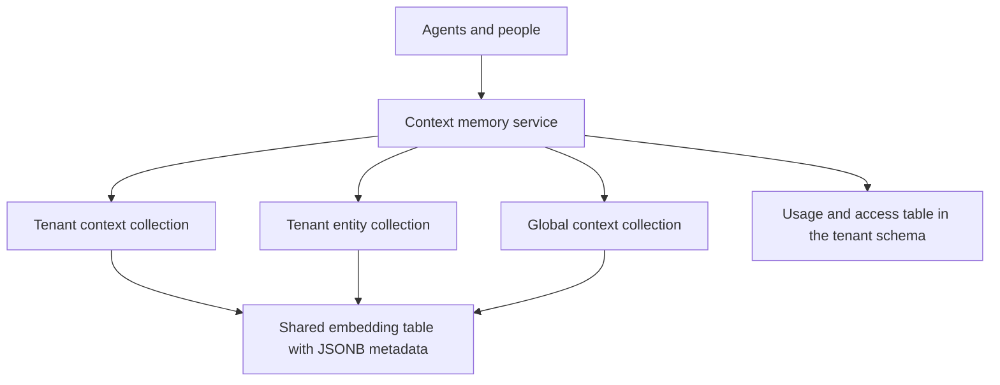
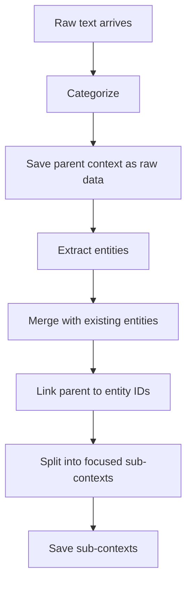

# Shared Memory for Agents That Never Meet

Two agents never talk to each other. One runs on Monday and learns that an IP address belongs to a partner's VPN gateway. The other runs on Thursday, for a different reason, and stumbles on the same IP. Unless something carries that knowledge from Monday to Thursday, the second agent starts from nothing and may well reach the opposite conclusion.

Context memory is that something: a shared, long-lived store that every agent can read and write, and that people can add to as well. People add documents, rules and how-to guides. Agents add what they learn while they work. This post covers how it was structured, how writes and reads flowed, and how one small table let us see which runs relied on which pieces of knowledge.

## Two kinds of node

Everything in memory is one of two node types.

A **context node** is a piece of knowledge: a sentence, a paragraph, a rule, a guide. Along with its text it carries:

- categories (what kind of knowledge it is, including whether it's an instruction the agent should follow)
- a context timestamp (when the fact was true) and a creation time
- who created it, a person or a specific agent
- where it came from: the run or uploaded file that produced it
- a scope, either global or one tenant
- a state, active or inactive
- the IDs of the entities it mentions

An **entity node** is a thing in the world: a user, a host, a domain, an IP address. It has a type, typed attributes, a natural-language description, and a risk level and tags that can change as more is learned.

The link between them is the important part. A context node points at the entities it is about. That's what lets the Thursday agent go from "this IP" to "everything anyone ever learned about this IP".

## One store for vectors and metadata

Both node types live in Postgres with [pgvector](https://github.com/pgvector/pgvector), through [LangChain](https://www.langchain.com)'s Postgres vector store. Every tenant gets two collections, one for context nodes and one for entity nodes, and global knowledge lives in a reserved collection of its own. Collections share a single embedding table. Each row holds the text, its embedding, and the full node as JSONB metadata.



We deliberately didn't run a separate vector database next to the main one. Most reads aren't purely semantic. They're "contexts about these entities, in these categories, from this time window, that are still active", with an optional similarity query on top. Keeping embeddings and metadata in the same row means one query can do both, inside the same database that already held everything else.

That decision led to three access paths, each used for a different job:

- **Similarity plus filter** when there's a query string: nearest neighbours, constrained by a metadata filter.
- **Metadata only** when there isn't: the same filter, ordered by creation time, with no embedding call and no vector scan at all.
- **IDs only, by cursor** for bulk maintenance: return just the matching IDs in ID order, starting after the last ID seen. This never uses offsets, so scanning a big collection costs the same on every page.

Updates to state, risk or tags merge into the JSONB metadata in place. Nothing gets re-embedded unless the text itself changes.

## Writing: keep the original first

Adding knowledge is the expensive direction, because understanding a document takes several model calls. The write path was ordered so that a failure at any step costs as little as possible.



1. **Categorize.** Some categories are known up front (a person uploading a rulebook says so). A model infers the rest.
2. **Save the parent immediately.** The raw text goes into memory as a parent context before anything else happens. If extraction or splitting fails later, the original is still there and still searchable. A partial result beats an empty one.
3. **Optionally return now.** Callers that don't need the derived nodes, like a person uploading a file, get the parent back at once. Everything else continues in the background.
4. **Extract and merge entities.** Entities mentioned in the text are pulled out, incomplete ones are dropped, and each is merged into memory (next section).
5. **Link.** The parent is updated with the IDs of its entities.
6. **Split.** The text is broken into small, focused sub-contexts, each pointing back at its parent and at the entities it mentions. Instructions such as rules and step-by-step guides are split separately from facts, because they're used differently.

Context IDs are a hash of the tenant and the content. Writing the same text twice produces the same ID, so a retry or a second agent learning the same fact is a no-op, not a duplicate.

## Merging entities without duplicates

Every agent that learns something about an entity would otherwise create a new copy of it. Merging is what keeps one IP address as one node.

For each extracted entity:

1. **Exact match first.** If the entity type has identifying attributes, such as the address of an IP or the name of a domain, look for a node with exactly those values.
2. **Fuzzy match if needed.** Otherwise, run a similarity search over entities of the same type and ask a model whether any candidate is the same thing.
3. **Merge or insert.** On a match, a model combines the two descriptions and reconciles risk and tags, list attributes are unioned, and the existing node is updated in place with its original ID and creation time kept. With no match, the entity is inserted as new.

Concurrency needed care. Two entities of the *same type* merging at the same time can both decide "no match" and insert twins. So entities were grouped by type: different types merged in parallel, entities of the same type merged one after another, and a semaphore capped how many merges ran at once overall.

## Reading: filters, scope, and the time window

Reads build a single filter out of whatever the caller knows:

- the source runs to include or exclude
- categories and entity IDs, matched by overlap with the node's lists
- a time window on the context timestamp
- state, where "active" also matches older nodes written before the state field existed, so adding the field needed no backfill
- origin: only what people added, or agent-learned knowledge as well

Two rules shaped the results. First, long raw parents were dropped in favour of their sub-contexts unless the caller asked for raw data, so the agent got the relevant paragraph instead of the whole document. Second, **human-added knowledge ignored the time window and agent-learned knowledge respected it.** A rule a person wrote last year still applies today. A fact an agent inferred last year may be stale. In practice that meant two queries, merged: one for human knowledge with no time bounds, one for agent knowledge with them.

## Correlating across agents and runs

The Thursday agent's question, "what do we know about this?", was answered entity-first:

1. Find the entity nodes that match what the agent is looking at, either exactly or permissively.
2. Fetch every context node whose entity list overlaps those IDs, from any agent and any run, using the human-versus-agent time rules above.
3. Keep only the entities that actually appear in the returned contexts, and deduplicate both lists by ID.

This is where the shared design paid off. The contexts in step 2 can come from a person's upload, a run by one agent last month, and a run by a different agent yesterday. None of those writers knew about each other. They only had to agree on the entity, and merging made sure there was only one.

Each context also kept its source reference, so the reader could tell *where* a piece of knowledge came from and choose to exclude its own run or trust only human input.

## The usage table: built for constant writes

Memory answers "what do we know?". We also wanted the reverse: which runs used which knowledge, and which knowledge is actually used. That came from a usage and access table in each tenant's schema:

```text
node id | node type (context or entity) | kind (usage or access) | subject type | subject id
        | extra context (JSONB) | created at | updated at
```

A *subject* is whatever consumed the memory: a particular run of a particular agent, or another part of the product. Every read that returned nodes wrote rows here, so this table took writes on the hottest path in the system. It was designed around that:

- **One row per relationship, not per event.** A unique constraint covers node, node type, kind, subject type and subject, with null subjects treated as equal. Reading the same context ten times in one run is one row whose timestamp moves, not ten rows.
- **Idempotent batch upserts.** Each read wrote all its rows in one bulk insert that updated the timestamp and extra context on conflict. Retries and concurrent readers converged on the same rows instead of failing or duplicating.
- **Normalize, then deduplicate.** IDs were trimmed before deduplicating the batch. Without that, `" abc "` and `"abc"` pass deduplication as two values and then collide inside the same upsert statement, which Postgres rejects.
- **Indexes that lead with the subject.** Two composite indexes start with subject type and subject ID and end with created and updated time. "Which memories did this run use, in order?" is a single index range scan. The node ID has its own index for the reverse question.
- **Never fail the read.** Tracking ran after results were computed and swallowed its own errors. Losing a usage row is a gap in analytics; failing a memory read stalls an agent.
- **Only real nodes.** Entity usage was checked against memory before writing, so the table never pointed at entities that didn't exist.

With this table, two runs that leaned on the same context were linked by a join, and a rerun could look up exactly which memories the first attempt had used.

## Decay: forgetting what agents learned

Memory that only grows gets worse over time, because stale agent conclusions crowd out current ones. So agent-learned knowledge decayed.

A scheduled retention job, enabled per tenant, walked each tenant's context collection. It selected nodes that were active, created by an agent, and older than a cutoff, and marked them inactive. A few properties made it safe to run against a store that agents were using at the same time:

- **Inactive, not deleted.** Decayed nodes stopped appearing in default reads but stayed available for audit, and a person could reactivate one.
- **Human knowledge never decayed.** The job only matched agent-created nodes.
- **Cursor batches.** It used the ID-only cursor scan described earlier, a batch at a time, so a large tenant didn't mean one huge query.
- **Metadata-only writes.** Marking a node inactive is a JSONB merge. No embeddings were recomputed, so decay cost a few cheap updates, not model calls.
- **One run per cycle.** A lock made sure only one worker ran retention at a time, even with many workers alive.

## Scope across tenants

Most knowledge belongs to a single tenant. Some, like general guidance, is useful everywhere, so it lives in the global collection, and reads can combine global and tenant results. For organizations that manage other tenants, contexts can be copied from one tenant to another. That's a copy, not a shared reference, so each tenant can later edit or deactivate its own version.

## Trade-offs

- **JSONB versus columns.** Filtering on metadata keys kept the schema flexible as node fields evolved, but those filters are only as fast as the indexes behind them, and a frequently filtered key eventually wants to become a real column.
- **Model-assisted merging.** Asking a model "is this the same entity?" catches matches that string comparison misses, at the cost of a model call per uncertain merge and the occasional wrong call. Exact matching first keeps those calls rare.
- **Background completion.** Returning after the parent is saved makes uploads feel instant. The cost is a short window where the parent exists but its entities and sub-contexts don't yet.
- **One shared embedding table.** Collections in one table are simple to operate and query, but every tenant's growth lands in the same table and the same vector index.

The core idea is simple to state: separate *what is known* (context) from *what it's about* (entities), make writes idempotent everywhere, and keep the original before deriving anything from it. Agents that never meet only have to agree on the entity, and the rest follows from that.

This memory is one of the things agents reach through the [agent harness](/blogs/agent-harness-architecture).
