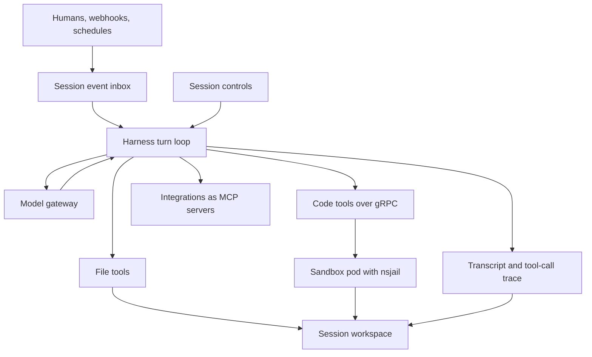
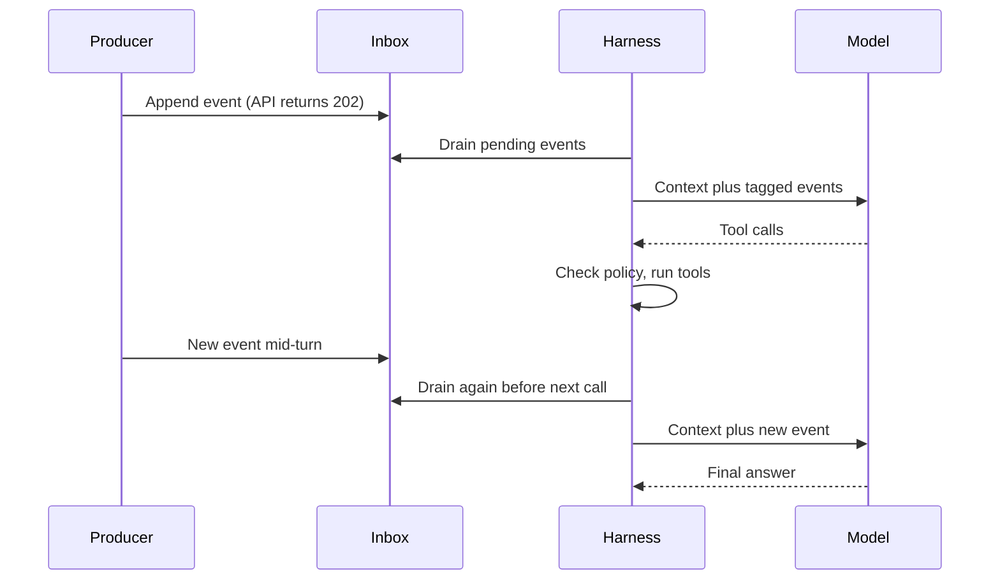

# A Thin Harness, a Dumb Sandbox, and Everything Is a File

A model call is the easy part of running an agent. Everything around it is the hard part: deciding what the model sees, running the code it asks for without trusting it, keeping a conversation alive across restarts, stopping it cleanly, and not paying for the same tokens twice.

That surrounding machinery is the harness. We built one to run many kinds of long-lived agents for many tenants on the same infrastructure. This post is the overview: what the pieces are, how a turn flows through them, and the rules that made it cheap and predictable. A few parts already have their own deep dives, which I link where they come up.

## Three layers, one rule

The harness is split into three layers, and the split is mostly about *where decisions live*.

1. **The harness** is a thin coordinator built on [Strands Agents](https://strandsagents.com). It assembles context, calls the model, checks every tool call against policy, records everything, and manages sessions and sub-agents.
2. **Sandbox pods** execute code. They run a small gRPC service that takes "run this shell command" or "run this Python" for a given workspace, wraps it in [nsjail](https://github.com/google/nsjail) with no network access, and returns the output. The pods carry no product logic.
3. **Shared storage** is a network filesystem mounted by both. Every tenant gets its own root, and every session gets a workspace inside it.

The rule that ties them together is **policy in the harness, execution in the sandbox**. The sandbox is deliberately dumb: it does what it's told. Every question of *whether* something may happen, such as which paths a tool can touch, which tools exist for this session, and how much budget is left, is answered in one place before the sandbox is ever called. That way there's exactly one place to audit and one place to fix.



Tools split along the same line. File reads, writes and edits run inside the harness against its own mount of the shared filesystem, because they're cheap and the harness already knows how to resolve a path safely. Shell and Python always go to the sandbox. Integrations with outside systems are wrapped as [MCP](https://modelcontextprotocol.io) servers, so the agent sees one uniform tool interface whether it is reading a file or querying another product.

Some MCP servers need context the model can't know, such as the ID of the record the session is working on. Rather than asking the model to thread that through every call, the harness binds it when the server is built, so the model's arguments stay small and can't point at someone else's data.

## Everything is a file

The second decision shaped almost everything else: **all session state is a file in the workspace.**

```text
session/
├── events/       pending and processed inbox entries, budget ledger
├── trace/        transcript.jsonl, one JSON record per tool call, sub-agent traces
├── skills/       the skills this session loaded, at pinned versions
└── ...           whatever the agent itself writes while it works
```

The database holds the session row: status, the controls snapshot, and pointers. The workspace holds the conversation and everything the agent produced. Put together, any worker can rebuild any session from the row plus the files. Nothing important lives only in a process's memory.

That's what makes the rest possible. A crashed worker loses its in-flight turn, not the session. Debugging a strange run means opening a directory, not reconstructing logs. And because skills, notes and memory are plain files too, the agent reads them with the same `file_read` it uses for everything else.

The full trace is also an audit record. Every tool call is written to its own JSON file with its inputs and full output, regardless of what later happens to the copy in the model's context. I wrote more about what survives a dead worker, and why, in [What Must Survive When an Agent Worker Disappears?](/blogs/sandbox-architecture).

## How a turn runs

Every input to a session goes through one door: an append-only inbox file. A human message, a webhook delivery, a system notification and a message from another session are all one JSON line with a source and some text.



Before every model call, a hook drains the inbox, archives what it read, and appends the events to the conversation as tagged messages (`<human>`, `<webhook>`, `<system>`). It archives *before* injecting, so a crash can't make the agent handle the same message twice.

The interesting property is the second drain. Events are read before *every* model call, not just at the start of a turn. A human watching the agent can redirect it while it is halfway through a chain of tool calls, and a webhook can land in the middle of a run and change what the agent does next. Producers don't need to know whether the session is busy. They append and walk away.

The HTTP request never waits for the turn. Posting a message appends the event, marks the session as processing, schedules the turn in the background, and returns `202 Accepted` within milliseconds. A turn survives a closed browser tab, and its length is bounded by the session's own duration budget instead of an HTTP timeout. The UI polls for history with a cursor, so each poll only reads what changed since the last one.

Behind the API there is a small lifecycle model:

- A **job template** is reusable: a prompt, a controls envelope, and optionally a schedule.
- A **session** is one conversation started from a template, with a status (pending, completed, failed, cancelled, paused) and a separate live state (processing or idle).
- A **task** is the claim handle a scheduler uses to run a session. It exists while the session is alive, stays claimed between turns so a follow-up message doesn't need a fresh claim, and is deleted in the same transaction that ends the session.

If a worker restarts, the scheduler's first step is to release tasks that were claimed by nobody, and the next worker resumes from the transcript on disk.

## Controls: what a session is allowed to do

Every session carries a **controls** snapshot, taken when it is created:

- **Permissions:** allow and deny lists of tools, with path or URL constraints where they apply, and glob patterns for families of integration tools.
- **Budgets:** caps on tool calls, model spend, iterations and wall-clock duration.
- **Sandbox limits:** CPU time, memory, wall-clock time and network access for jailed code.

The runtime reads only the snapshot, never the template it came from. Editing a template changes future sessions, not running ones, so a session's behaviour can't shift underneath it mid-run. Agents also can't ask to widen their own grants at runtime: a tool is either allowed for the session or it isn't.

Each tool call is checked against the snapshot in the harness. Repeated denials are fed back to the model as information, so it learns to stop trying instead of looping. Each run also acts for the person who started it. A scheduled or delegated run carries that user's identity through background jobs, so what the agent can reach is never more than what they can reach. The storage side of that model is its own story, in [Migrating Agent Permissions Without Granting Anything New](/blogs/permissions-json-to-relational-rows).

Budgets come in two strengths. Hard caps stop the run. Soft warnings tell the model it is close to a limit so it can wrap up cleanly. How that warning is injected matters for caching, which is the next section.

## Prompt caching is a design constraint, not a setting

A long-running agent re-sends its whole context on every model call. Providers cache a request's prefix, so if the start of the prompt is byte-for-byte the same as last time, those tokens are cheaper and faster. For an agent that makes hundreds of calls in one session, prefix stability is the difference between paying for the conversation once and paying for it on every call.

So we treated "don't change the prefix" as a rule the whole harness has to follow:

```text
[ static system prompt ][ tool list ] | boundary | [ workspace notes, memory, deferred-tool list ]
[ conversation, append-only ................................................ ][ request-local tail ]
```

- **Static first, dynamic below a boundary.** The system prompt is split by a marker. Everything above it is identical for every turn. Anything that changes, such as workspace notes, memory, and the list of tools not yet loaded, lives below the marker, so refreshing it doesn't invalidate the static part.
- **A stable tool list.** Tools from integrations are *deferred*: the model sees their names, and loads a schema with a search tool only when it needs one. Loading one shouldn't reshuffle the declared tool list, so where the provider supports it, newly loaded schemas are declared alongside the request instead of in the root list. Context management keeps search results alive longer than other tool results for the same reason: evicting a schema the model is about to use costs a whole extra call.
- **Append, never rewrite.** The conversation only grows. Nothing goes back and edits an earlier message.
- **Transient nudges go in the tail.** A budget warning is appended only to the outbound request, never to the system prompt or the stored history. If it were written into the history, every later call would carry a different prefix.
- **Forks share the cache.** A forked sub-agent gets the parent's system prompt, tool order and conversation exactly, so its first call reads the parent's cached prefix. Overriding the fork's model breaks that, and the harness logs a warning when it happens.
- **Route consistently.** Caching only helps if requests from one session land where the cache lives. That depends on a stable session key reaching the model gateway, which I learned the hard way in [The Session ID That Never Reached the LLM Proxy](/blogs/llm-gateway-cache-and-cost).

The one thing that deliberately breaks the prefix is compaction, because a summary *is* a new prefix. That's acceptable as long as it happens once per compaction, not once per turn.

## Context management

A long session eventually outgrows the context window. The naive fix, a sliding window that drops the oldest messages, throws away exactly the tool results and file reads the agent may still need. Ours is a pipeline in which the cheap steps run first and only the expensive one calls a model:

1. **Truncate on write.** A tool result over a few thousand tokens is replaced in context with a preview and a pointer to its full JSON record in the trace. The full output is never lost, it just isn't re-sent on every call.
2. **Micro-compaction.** Before each model call, older tool results beyond the most recent handful become short stubs that cite their record on disk. No model call, and it reclaims a large share of context.
3. **Pressure watch.** A cheap token estimate decides when the session is getting close to full.
4. **Summarize and reconstruct.** Past a threshold, at the start of a turn, a cheaper model summarizes the old turns. The context is rebuilt as the summary, a log of the tool calls that were made (file reads are tool calls, so their content comes back through that log), and the most recent turns intact.
5. **Output recovery.** If the model hits its output limit mid-answer, the harness asks it to continue from where it stopped, a bounded number of times.

There's also an emergency branch with tighter limits for when the provider rejects a prompt as too long anyway.

The most important detail is persistence. The summary is written to the transcript together with a boundary marker, and the transcript loader only seeds the next turn from the last boundary onward. Without that, every turn reloads the full history and pays to summarize it again. The whole transcript stays on disk for audit. I wrote about that bug and its fix in [Compacting an Agent Is Easy. Keeping It Compacted Is Not.](/blogs/agent-context-management)

Skills are exempt from compaction. A skill's instructions are the plan the agent is following, and replacing them with a stub mid-run would erase the plan.

## Skills: instructions that load on demand

Skills use the open SKILL.md format: a folder with instructions and optional scripts and reference files. They're versioned, and when a session starts, the latest stable version of each skill is copied into that session's own workspace. Two sessions for the same tenant never share a skills directory, so publishing a new version can't change a run that's already in progress.

The agent sees skills in three levels of detail. Its system prompt lists each skill's name and one-line description. Calling the skill tool returns the full instructions plus a list of the files bundled with it. The agent reads those files only if it needs them. A large library costs a few lines of prompt until a skill is actually used.

## Sub-agents

Fan-out is exposed as ordinary tools, not as a special harness feature:

- **Fresh workers** start with no parent history and a restricted set of tools. Worker types such as explore, plan and analyze each declare which tools they can't use, which model tier they default to, and what shared context to inject.
- **Forks** share the parent's full conversation and prompt, which is what makes them cheap: they start from the parent's cached prefix.

Both are async tools, so several can run in parallel from one model response. Only general-purpose workers and the main agent can spawn more agents, which prevents runaway recursive fan-out. A sub-agent inherits the parent's resource permissions and can't exceed them. Each child gets its own trace directory, so the parent's transcript stays readable. Its lifecycle events (started, message, tool use, finished, plus a heartbeat every thirty seconds) are reported back to the parent session so the UI can show what each child is doing. Token spend is attributed per agent.

## Stopping cleanly

Stop is cooperative. Pressing it writes a cancel marker into the session's inbox with a reason, and the running turn honours it only at **safe boundaries**: after a tool result has been recorded and before the next model call.

Killing the task outright was tempting and wrong. It can leave the conversation with a tool call that has no matching result, which providers reject on resume, and it can cut off a sandbox process halfway through writing a file. Waiting for a boundary keeps the transcript well-formed, so the session can always be continued later.

The reason decides the outcome: a user stop becomes *cancelled*, marking it done becomes *completed*, and running out of time becomes *paused*, which can be resumed. Paused time doesn't count against the duration budget. Sub-agents share the parent's workspace, so they see the same marker at their own next boundary without any extra signalling. The cost is latency: usually seconds, longer if the model is in the middle of a long streamed reply.

## What we'd still change

- **Polling, not streaming.** Polling with cursors is simple and works with any worker, but it costs requests and a little latency. Streaming turn events would be nicer once the event shapes settle.
- **Signalling between sessions stays inside one process.** A session waiting on another session's reply uses an in-process signal, so both have to live on the same worker. Spreading that across workers needs a real pub/sub channel.
- **Thresholds are tuned per provider.** The compaction thresholds and summarizer settings were calibrated against one model family. The pipeline itself is provider-agnostic; the numbers aren't.

The pattern that held up best is the one at the top. Keep policy in one place, keep execution dumb, and write every piece of state to a file. Most later features, including mid-turn messages, forks that share a cache, compaction that survives restarts, and clean cancellation, came out of those three choices instead of fighting them.
