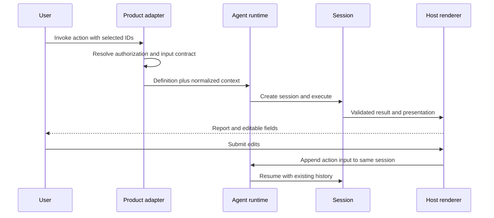

# Building a Workflow Button Without Building a Workflow Engine Twice

From the user's side, the feature is simple. They select a few rows and click an action. A generated report appears, they tweak a field, and they submit.

From the backend, that button needs inputs, permissions, execution state, a rendered result, retries, and a way to continue after a human has reviewed the output. Our agent runtime already had nearly all of that. The real risk was that the button feature would quietly grow its own copy of each piece.

The rule I designed around was that the button is an **adapter**, not a second engine. The product supplies context, the runtime executes, the host renders a validated result, and a follow-up action continues the same session.

## The feature is an adapter, not a new scheduler

An action is backed by an ordinary execution definition that holds the instructions, execution mode, and allowed capabilities. Invoking it passes normalized input into one persistent session. The action layer has no worker loop and no conversation store of its own.

The platform still knows the action's input contract, capability boundary, and result schema. What it doesn't know is anything domain-specific, like which ticket field to update or which paragraph of the report to write.



One invocation is one session, even if the user selected five rows. That gives them one place to see what happened. A workflow can still fan out internally. That's the workflow's decision, not the button's.

## Placements: where the button lives and what it carries

The same action behaves differently depending on where it appears. On a detail page there's usually a parent session to attach to. In a list, there's a set of selected IDs across the accounts the user can see, and no parent at all.

I modelled each location as a registered **placement**: a slot key plus an exact context schema version. Product apps register their placements and the strategies that build the context from their own startup hooks. The runtime owns the registry and validation, and it never imports product code. The dependency only points one way, so adding a new slot never touches the runtime.

A few rules made this hold up:

- **No implicit "latest".** If the browser and backend disagree about the context shape, falling back to the newest adapter silently changes what the agent receives. An unavailable exact version is a clear error.
- **The descriptor declares the linkage policy:** forbidden, optional, or required. An action row on a detail page *requires* the current session as its parent. A list action *forbids* one, because a stray parent there would corrupt what the run is attached to. Clients never choose linkage. The registered strategy does.
- **Context is bounded.** It's serialized as compact JSON, with a size limit checked before and after the strategy runs. Without that, a shortcut can end up pasting a database dump into the prompt.
- **The browser supplies candidate IDs, never tenant identity.** The backend resolves those IDs within the caller's authorized accounts and rejects collisions across schemas.
- **An empty selection stays empty.** It never expands into "every row matching the current filter." That's the kind of decision that ends with emailing the wrong customers.

The same validator runs at registration, in health checks, in readiness checks, and at launch. There's exactly one definition of a valid placement in the system.

## The result is data, the host draws the UI

The first run produces a report and a structured result. I didn't want the agent emitting an interface, because every widget an agent can author is a place someone could smuggle code into the product. Instead, the result can carry a **presentation**: a small, schema-bound tree that the host renders.

The grammar is closed on purpose. It's one `row` or `column` of leaf nodes, and the leaves come in three families: inputs bound to the result schema, editable templated HTML or Markdown, and buttons whose disabled state comes from a boolean in the result. A new widget means registering a new node kind, not loosening the grammar.

```json
{
  "summary": "Three records need review.",
  "destination": "review-queue",
  "can_submit": true
}
```

A presentation can bind a summary, an editable destination, and a submit button to those fields. The host decides which widgets exist and how a click reaches the backend. The agent supplies data, never a script holding product credentials. Customer-supplied HTML renders inert in a sandboxed frame with no script. That frame is a boundary, not a substitute for sanitizing rendered content or authorizing the submit operation.

When the human submits, their edits are uploaded as action input, a fixed instruction message is posted, and the **same session** resumes. The agent that wrote the report is the one that gets corrected, with all its evidence still in context. Starting a new session there would throw away the reasoning behind the report the human just reviewed.

Templates and assets are pinned into the session snapshot when it starts. If someone edits the workflow tomorrow, yesterday's result still renders the way it did. Bindings are stricter than templates: a dangling template reference is a broken paragraph, but a dangling binding is a button that silently does nothing, so bindings reject them.

## Distribution exposed the real ownership boundary

Then came distribution: pushing an action from a parent tenant down to its children. The copied row lived in the child's database, but its content still belonged to the parent. The child could own whether the action was enabled without owning the execution definition behind it.

Locking the action editor in the UI wasn't enough. A generic definition API or an agent tool could reach the same underlying object and bypass the restriction. So the ownership check went into the **shared write boundary**, where every path has to go through it.

Settings that allow local overrides use a three-way merge:

```text
local == last_applied_parent_value  -> accept incoming parent value
local != last_applied_parent_value  -> preserve local override
```

For example, a parent once pushed a 30-minute interval. One child still has 30 minutes and another changed it to 60. When the parent's new default is 45, the first child should move to 45 and the second should stay at 60. Without storing the last applied baseline, you can't tell an untouched inherited value from a deliberate customization that happens to differ from today's parent.

Not every field uses that merge. Parent-owned execution content and child-owned operational switches each get their own explicit rule. If a child already owns a resource under the requested key, the push keeps it and reports a conflict. Silent replacement would turn distribution into accidental data loss.

## A portable definition still has dependencies

An exported action can reference presentations, skills, and executable packages. I resolve those from the actual references in the definition, rather than assuming a dependency shares the action's name. That assumption breaks the first time a resource comes from a separately named family.

A bundle can't install product code just by carrying a placement key. If the destination doesn't have that adapter registered, import keeps the configuration, reports the missing dependency, and leaves the placement disabled with a warning. A disabled button is honest. A button whose strategy doesn't exist is a trap.

## Where that left the feature

The result is a deliberately small product layer, though not a trivial one. It owns context and ownership at the boundary. The runtime owns execution and continuity, and the renderer owns interaction. Keeping those three separate let the feature reuse the whole platform without turning into another platform inside it.
