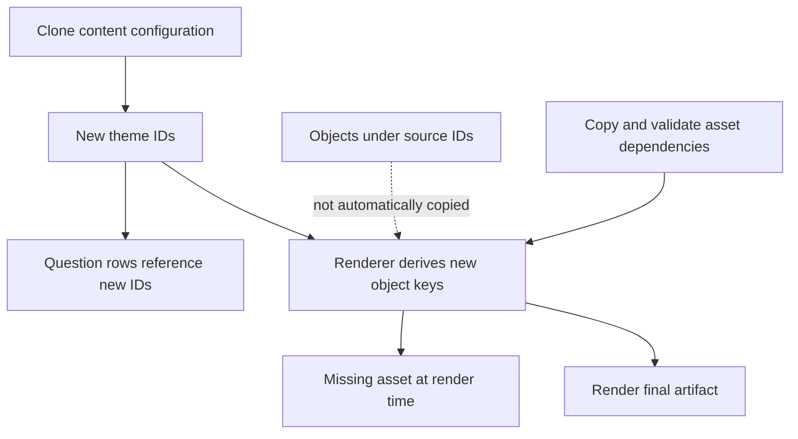

# The Database Migration Passed. The Images Were Still Missing.

We had cloned a batch of content configuration into new database rows. The migration succeeded. The rows existed, every foreign key was valid, and the new challenges pointed at the right themes. The images and audio those challenges needed were nowhere to be found.

Once I followed the path-building code, the cause was obvious. The asset keys in object storage contained the database theme ID. Cloning a theme gave it a new ID, and nothing about that SQL operation copied the files stored under the old one.

The database held a complete graph of rows and an incomplete graph of content. The migration tool couldn't have caught that, because the missing piece lived outside anything it could see.

## The reference was hiding in a path

Here's a simplified version of the layout:

```text
database:
  theme 73  -> source questions
  theme 290 -> cloned questions

object storage:
  themes/73/question.png
  themes/290/question.png  [missing]
```

No column stored a URL from the cloned row to the source object. The application derived the expected key from the new ID at render time. A foreign-key check has no way to notice that a derived file doesn't exist.

Different activity types made it more interesting. Some expected one image, some an ordered series of question images, and some audio under a different prefix entirely. A generic database copy knew about none of those dependencies.



The renderer was where the problem surfaced, but it wasn't the renderer's job to invent missing content. This was a release problem.

## Copying the files wasn't enough

I traced the expected keys for every cloned configuration and copied the missing objects over from their source themes. **24 cloned challenge configurations** were affected.

Then it got trickier. Some of the source images were JPEGs, while the destination contract expected PNGs. Copying JPEG bytes to a `.png` key makes the file exist without making it a PNG. Those images had to be decoded and re-encoded, not renamed.

A browser might sniff the bytes and display it anyway, but other consumers rely on the content type, the extension, or a stricter decoding library. "Storage returned 200" isn't a format check. So the dependency check has two levels: does the object exist at the expected key, and does it actually contain what the consumer expects?

## Promoting configuration is narrower than copying a database

The same product kept activity definitions and progression rules in database tables. We promoted an explicit allowlist of those configuration tables through generated Alembic data migrations. That made database-driven behavior reviewable, without dragging development users or operational history into production.

The flow looked like this:

```text
compare allowed configuration tables
  -> generate a migration
  -> review the operations
  -> rehearse against the target schema
  -> deploy with the release
```

Both environments need to be on the expected schema revision before you compare. Stable identities and foreign-key ordering matter. Environment-specific values, like credentials or infrastructure endpoints, have to stay out of the portable diff.

Even a perfect configuration migration can't copy dependencies it doesn't model, though. The missing images showed exactly where "configuration = the rows in the allowlist" stopped being true.

## Rendering is one more boundary

These challenges ended up as shareable images. Results were turned into visual cards through templates, a headless browser, and object storage. I treated that as a backend pipeline, not a screenshot utility, because each stage can fail on its own:

- A browser will happily capture HTML with a broken image in it.
- An upload can succeed while the application never saves the object reference.
- A row marked *ready* only means something if the referenced object can be retrieved and contains the right thing.

A few rules came out of that:

- **Persist stable object keys, not signed URLs.** Signed URLs expire. They're delivery credentials, not identities. A retryable job should request a fresh URL, not carry a dead one in its payload.
- **Treat the renderer's network access as server access.** An image URL in a template becomes a request from inside your infrastructure. Restricting the browser to the asset origins and font hosts the pipeline needs stops a content field from becoming an SSRF path. Escaping HTML and restricting network access are separate protections, and you need both.
- **Let status reflect publication.** "Ready" means the stored object and the saved reference agree, not that a rendering subprocess exited with code 0.

## Validate from the consumer backward

For the affected content, I checked every derived destination key and repaired the missing objects, including the format conversions. The broader check I'd keep for every release starts from what the user will actually load and works backward:

| Boundary | Check |
| --- | --- |
| Configuration | Expected rows, relationships, and schema revision |
| Asset references | Every derived key resolves |
| Asset bytes | Expected media format and usable content |
| Rendering | Required assets appear in a real artifact |
| Publication | Saved reference resolves to the published object |

A content manifest would make more of this explicit. I didn't need one to diagnose this incident, because following the path-building code was enough to see why the SQL clone hadn't cloned the content.

I didn't take the lesson to be "make the migration tool responsible for everything." It was to stop calling a release done at the last database boundary when the content still has to make it through object storage and rendering before a user can see it.
