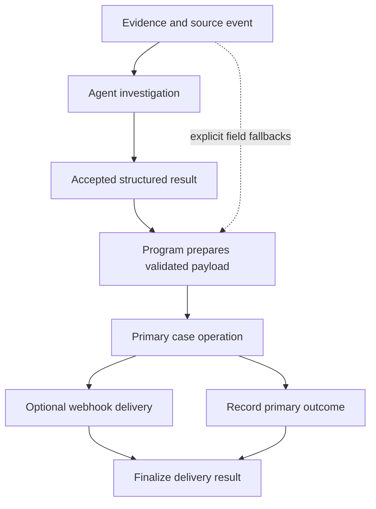

# Taking the LLM Out of a Workflow's Last Mile

By the time this step ran, the thinking was done. An agent had investigated, gathered evidence, and reached a conclusion. All that was left was mechanical: map the result onto known fields, create or link a case, send a configured webhook, and record the outcome.

Yet we were running that step through another reasoning loop. That added variance where we needed a contract. A severity label shouldn't change because a second agent phrased its interpretation differently. A webhook hostname shouldn't depend on whether a model remembered to strip the URL path.

So I moved the last mile into a versioned Python executable that runs inside the same agent runtime. The investigation still uses an agent. Delivery takes the accepted result as data. In the validation runs, the delivery path made **no model calls at all**.

## Draw the line after the judgment

The program doesn't redo the investigation. It uses the investigation's summary and severity first, and falls back to explicitly defined source fields only when those are missing.

That precedence matters more than it looks. The raw event and the finished analysis can legitimately disagree, because the agent may have raised or lowered the severity based on what it found. If delivery recomputed severity from the raw event, it would quietly undo the investigation's conclusion.



The handoff between agent and program needs a stable data shape. Without one, the program just becomes another interpreter of free-form prose.

## Field transformations are just code

One integration wanted a hostname rather than a full URL. That's a job for a URL parser, not string slicing:

```python
from urllib.parse import urlsplit

source_url = "https://Example.test:8443/incidents/123?view=full"
host = urlsplit(source_url).hostname  # "example.test"
```

The scheme, port, path, and query are all gone, and the case is normalized. Parsing a URL isn't the same as being allowed to contact it, though. The caller still validates the scheme and the expected destination.

The other mappings were just as explicit: accepted investigation fields first, known raw fields second, defined severity conversions, and an opt-in flag for the secondary webhook. A missing required field fails during preparation. It doesn't become an invitation for a model to improvise.

## Stay inside the runtime's boundaries

The program calls tools through the runtime's broker. It doesn't import credentials and hit providers directly. That keeps permissions, execution identity, and traces on the same path as the rest of the platform.

Being deterministic doesn't make a program safe. It can deterministically send the wrong payload, or skip a policy check if you give it a side door. What you gain is that its transformations and its allowed side effects can be inspected.

The workflow also pins a specific executable version. Promoting a newer package affects future runs only. It never changes which code is associated with a historical session.

## Partial success didn't go away

Creating the case and sending the webhook are two separate side effects. If the case is created and the webhook fails, rerunning the whole workflow can create the case a second time.

So the result has to keep the primary reference even when the secondary step fails. Conceptually:

```json
{
  "primary": {"status": "completed", "reference": "case-123"},
  "delivery": {"status": "failed", "retryable": true}
}
```

A single `success: false` can't tell "nothing happened" apart from "the case exists, but the notification didn't go out." Those need very different recovery.

Rate limits and transient server errors justify bounded retries at the delivery step. Invalid input and authentication failures need a person, not more attempts. A timeout is genuinely ambiguous: the remote side may have processed the request before the response got lost. Preventing duplicates there needs an idempotency key or a lookup against the destination. Taking the call away from an LLM doesn't buy you exactly-once delivery.

## The first failures weren't about reasoning at all

During validation, one destination turned out to be an offline tunnel. Later attempts timed out at the broker. No amount of re-running the reasoning step could have fixed either one. Before retrying a mutation, you have to check that the destination is reachable with something that has no side effects.

Once the test receiver was up, **four local workflow executions completed with HTTP 200 delivery**. I went through their traces: the expected provider lookup, case operation, webhook, and finalization all ran. The executable version matched the package I'd tested, and recorded usage showed zero model calls and zero goal evaluations for those runs.

One caveat I kept explicit is that the test receiver accepted anything. That proved payload construction and HTTP delivery. It didn't prove a real ticket got created in the downstream product. A green end-to-end test against a permissive receiver can still hide a schema error on the real destination.

## What changed, and what's still hard

The delivery path no longer asks a model to make the same field decisions on every run. Its mapping rules can be tested directly against missing analysis, different source variants, malformed URLs, optional delivery, and transient failures.

The runtime still owns admission, dependency resolution, permissions, scheduling, and durable outcomes. A pinned executable can still fail before it starts. A tool can still return an error inside a successful-looking transport envelope. External delivery still has partial success.

The lesson was narrower than "replace agents with code." Keep the agent where the evidence needs judgment. Once a result has been accepted, stop asking another model to rediscover the delivery contract.
