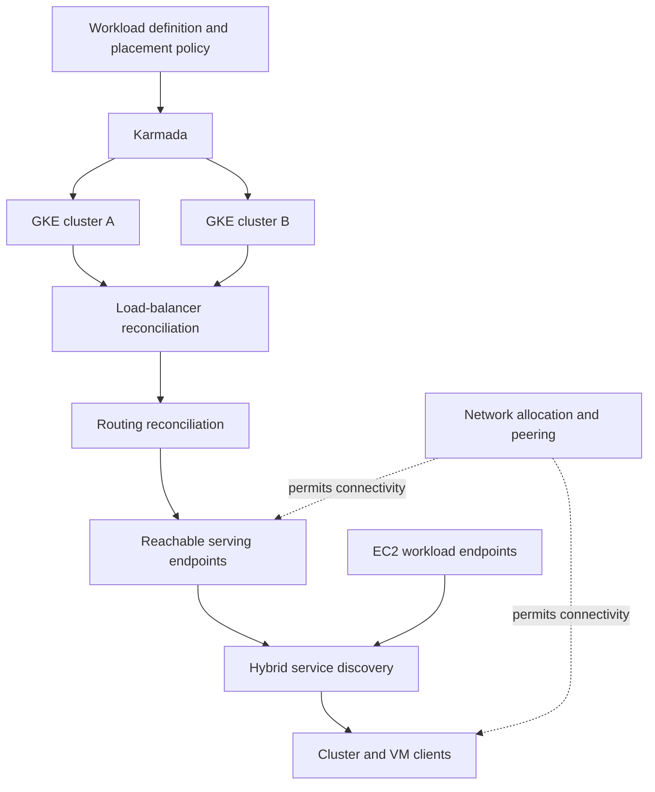

# A Deployment Is Not Reachable Just Because Its Pods Are Running

Kubernetes will happily report a healthy Deployment that nobody can reach. The scheduler did its job and the pods are running. What's missing is a cloud load balancer, a route, a name the client can resolve, or a network path between two VPCs.

I worked on exactly that gap, building four related pieces:

- a **Karmada-based deployment system** for multi-cluster GKE,
- **two Go operators**, one that provisions load balancers and one that keeps routing up to date,
- **Fabric**, a Go service-discovery system spanning Kubernetes and EC2,
- a **network API** for CIDR allocation and cross-account VPC peering on AWS and GCP.

None of them was a magic controller that made traffic work on its own. The most useful thing I learned was where each one's responsibility stopped and the next one's began.

## Follow a request backward

Picture a service running on an EC2 instance that needs to call a workload placed somewhere in our GKE clusters. For that call to work, four questions need compatible answers:

1. Where should the workload run?
2. Which serving endpoint reaches it?
3. What name should the client resolve?
4. Can packets travel between the two networks?

A placement policy answers the first one and says nothing about the other three.

Each arrow is a dependency between different systems. A DNS answer and a reachable address are not the same thing.

## Placement: one workload, one policy

Before Karmada, "multi-cluster" meant a deploy job that ran `kubectl apply` against each cluster in turn. That's two chances to drift. One cluster misses a hotfix. Someone `kubectl edit`s the other. And nothing in that script knows how to put the extra replicas somewhere else when a cluster goes down.

With Karmada, a workload is declared once alongside a **PropagationPolicy**, which says which clusters are eligible and how replicas are split. An **OverridePolicy** covers the things that really do differ per cluster, like an ingress hostname, a node pool, or per-region secrets. Any difference that isn't in an override gets patched by hand eventually and then lost.

Failover is that policy executing, not a person re-running a pipeline. "Failover" needs a precise meaning, though. Our cluster health came from the API server and node pools, not from the application's error rate. An unreachable control plane and an app returning 5xx are different failures, and Karmada only reacts to the signals it's given. Any failover arrow in a diagram should say what makes it fire.

Placement also doesn't create networking. Karmada puts the workload in the right clusters, and each cluster still needs its own cloud resources before anything can reach it. That's what the operators were for.

## Two operators, two kinds of work

I split the cloud side into two Go operators: one provisions load balancers and the other reconciles routing. That gave each control loop a resource it clearly owned, so a Service change didn't trigger some indistinguishable bundle of cloud calls.

The split mattered most for shared state. If two reconcilers both rewrite the same routing document, each can erase what the other wanted. So each operator computes the state it owns from current inputs, applies an idempotent change, and reports whether the observed state has caught up. Getting an event isn't, by itself, a reason to make a cloud API write.

Batching related routing changes cuts down on API calls. A batch queue is only safe if the desired routes can be rebuilt after a restart, though. Otherwise the queue becomes the only copy of pending work, and it disappears with the pod.

Cloud quotas were part of the controller design from the start. Retries in the SDK nested inside retries in the work queue can turn a throttled rollout into a much bigger one. You have to decide who owns retries, and how many writes can be outstanding at once, together.

## Fabric: one name for Kubernetes and EC2

Some services stayed on EC2 while others moved to GKE, and callers shouldn't have had to care which. Kubernetes gives you `foo.ns.svc.cluster.local`. EC2 gives you an instance tag and an IP address that changes when the instance is replaced. In-cluster DNS knows nothing about the VMs, and the VMs don't run kube-proxy.

Fabric watches both worlds and serves a single view of them:

- A record is `(name, backends, health)`. The name is a short label, not a cloud resource ID. Each backend is an `IP:port` tagged with its source (`k8s` or `ec2`), so when something looks wrong you can tell which watcher put it there.
- The Kubernetes side follows EndpointSlices. The EC2 side follows Auto Scaling group instance state plus an explicit Fabric tag. An instance without the tag isn't included. Automatically including every VM in the VPC is how a bastion host ends up answering as `payments`.
- Health is active. An instance the cloud reports as running, with a dead process inside, is the most common failure, so Fabric probes the port it's about to hand out.
- There are two ways to query it. DNS serves clients that can only speak DNS. An HTTP lookup API returns every backend for clients that want to choose their own. TTLs are short, because caching a dead backend for a minute is worse than a few extra lookups.

Fabric solves naming. It doesn't solve connectivity. Handing a VM a ClusterIP it has no route to just moves the failure from name resolution to connection setup. The addresses Fabric publishes have to be reachable from the clients that ask for them, which leads to the last piece.

## Network API: allocation comes before connectivity

Teams regularly needed a VPC in another account, peered back to everything else, with an address range that didn't overlap anything already routed. That used to go through a ticket. The person filing it couldn't see overlaps, and they'd pick `10.0.0.0/16` because every tutorial does.

The network API I worked on turned that into a call: allocate a prefix, create the VPC, peer it, write the routes. The cloud SDK calls were the easy half. **The allocator was the product.**

- **A single ledger** of allocated prefixes per region and account, taken under a lock, so two requests can never carve out the same block. Live cloud state lags behind, so you can't infer allocations from it. The ledger is the source of truth.
- **Small by default.** IPv4 space is the real constraint, so requests default to a `/24`, and a `/22` needs a recorded reason.
- **Release only when the network is really gone.** An orphaned reservation is cheap to investigate. Reusing a prefix while an old route still points at it is how you blackhole another team's traffic.
- **One interface, two clouds.** AWS and GCP model peering differently, so callers see `peer(src, dst)` and the implementation is two adapters. Exposing AWS-specific calls would have locked every caller in forever.
- **Fail closed.** Overlaps are rejected outright. Route propagation is explicit, because an auto-accepted peering with no routes is a green API response and a blackhole. The response returns the CIDR that was actually allocated, which may differ from what the caller asked for.

Reserving address space, creating cloud resources, and seeing working connectivity are three separate states. A partial failure can leave any combination of them done.

## Report the boundary that failed

All of this pushes toward one idea: status shouldn't be a single "deployed" boolean. Placement, endpoint provisioning, routing, and discovery each report their own state. Then an operator can tell a healthy workload with a missing route apart from a missing workload behind a perfectly healthy load balancer.

The separation pays off again during recovery. Rebuilding routing doesn't redeploy every workload. Replacing a VM doesn't force every consumer to learn a new IP. Moving replicas doesn't silently imply that traffic moved with them.

Each control loop makes one small, checkable claim: this workload is placed, this endpoint is provisioned, this route is observed, this name resolves. Reachability is all of those together, not any one of them.
