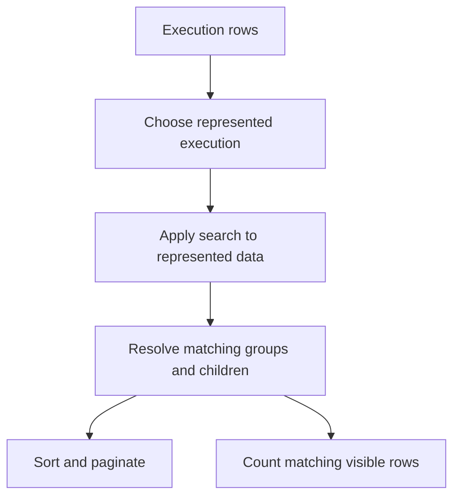

# A JSON Search That Returned the Right Rows and Scanned the Wrong Data

The request was reasonable. Users wanted to search inside an investigation's JSON, not just its title. The identifiers they remembered, like an IP address, were already stored there. Nobody should need to know which nested field holds the value they're looking for.

The first implementation looked reasonable too: cast the JSON to text and run a case-insensitive substring match. Things got complicated when that one predicate met a multi-tenant list endpoint with grouped rows, two database engines (PostgreSQL and a columnar store), and separate page and count queries.

I came out of it with a real query-plan fix, a clearer search contract, and a set of benchmarks that told me something less comfortable: arbitrary substring search over JSON wasn't cheap enough to switch on without limits.

## The list is a projection, not a table

An investigation can have several executions. The list shows the newest relevant one, collapses related rows, and reveals children only when you expand a parent.

Search has to respect that. If an *old* execution mentions an IP address but the one on screen doesn't, matching on the old JSON produces a row that seems to have nothing to do with your query. If a child matches, its parent needs to stay visible, but expanding the parent shouldn't dump every unrelated child.

The page, the total count, group membership, and ancestor visibility all have to follow the same rule. Each branch of the SQL can be individually correct while the endpoint as a whole is inconsistent, because the branches disagree about what a row *means*.



That's the logical order. The optimizer can execute it however it likes, which turned out to matter.

## A tenant filter that was correct and still too slow

The columnar store keeps many tenants in shared tables. One expensive subquery had exactly the right tenant condition:

```sql
EXISTS (
    SELECT 1
    FROM executions e
    WHERE e.tenant_id = visible.tenant_id
      AND e.id = visible.execution_id
      AND LOWER(CAST(e.analysis AS STRING)) LIKE '%needle%'
)
```

Logically, that can never return another tenant's data. Physically, the engine planned the correlation as a semi-join and didn't push the tenant condition down into the scan. So it could serialize and search JSON for a much larger population before the join threw the irrelevant rows away.

The fix was to repeat the already-authorized tenant set inside the subquery, so the scan gets its own predicate:

```sql
AND e.tenant_id IN ('tenant_a', 'tenant_b')
```

That set is bound from server-side authorization, never taken from the browser. And I didn't trust the SQL text alone. I checked the scan predicates in the plan to confirm the restriction actually reached the scan. Adding a condition to a query doesn't prove the optimizer used it where you hoped.

That gave me a distinction I keep using: **tenant isolation protects the result; tenant pruning limits the work needed to produce it.** A multi-tenant query needs both.

## PostgreSQL told a different story

The PostgreSQL path needed its own numbers, so I built a local benchmark. The first dataset had **50,000 rows** generated from a handful of real document shapes. Serialized JSON averaged about 14 KB, peaked around 30 KB, and came to roughly 669 MiB of text in total.

Warm-cache substring scans, for both all-match and no-match terms, took about **5.6–5.8 seconds**. Four concurrent no-match scans each took about 6–6.4 seconds. Anonymous memory rose by only tens of MiB, with no OOM.

That ruled out one fear: the scan wasn't holding the whole serialized corpus in memory. It didn't make the endpoint safe. JSON serialization still burns CPU and read bandwidth.

Then I scaled up to something closer to the real endpoint:

| Experiment | Observed result | Important limit |
| --- | --- | --- |
| 50,000 rows, simple scan | About 5.6 to 5.8 seconds | Warm cache, repeated document shapes |
| Same scan, four concurrent callers | About 6 to 6.4 seconds each | Not the complete listing query |
| 500,000 rows, list-like workload, 20 callers | Successful-request median about 304 seconds | Partial run, different query shape |

The last row included filtering, deduplication, sorting, and the page and count queries. Of 1,000 planned requests, 120 completed, 20 in-flight queries were deliberately cancelled, and 860 never ran. That's not a finished load test, and the 120 that completed aren't a fair latency sample. Data size and query shape both changed between rows, so this isn't a scaling curve either.

What the numbers do show is clear enough: checking memory on a single scan tells you nothing about how the endpoint behaves under concurrency.

## Why the existing JSON index didn't help

A JSONB containment index answers "does this document contain this structure?" That's a different question from arbitrary substring search over serialized text. A trigram index on a matching expression can help PostgreSQL, but short terms, broad terms, and heap rechecks all eat into it.

A maintained search projection would avoid re-serializing on every query. Its cost moves to every write: each change to searchable content has to refresh the projection, plus a backfill. That's a real option, but this benchmark didn't measure it.

The columnar store had its own representation and indexing limits, so copying the PostgreSQL approach wasn't a plan for both engines either.

## Where it landed

I fixed the missing physical tenant restriction and verified it in the scan predicates. I wrote down the search contract around represented executions and grouped children, so the page, count, and expansion queries all agree. Neither of those meant the full endpoint would stay responsive under production concurrency.

What was left was a product and query-design decision, with real numbers behind it: narrow what's searchable, maintain an indexed representation, or accept bounded expensive searches. "The query returns the right rows" had stopped being enough to choose between those.
