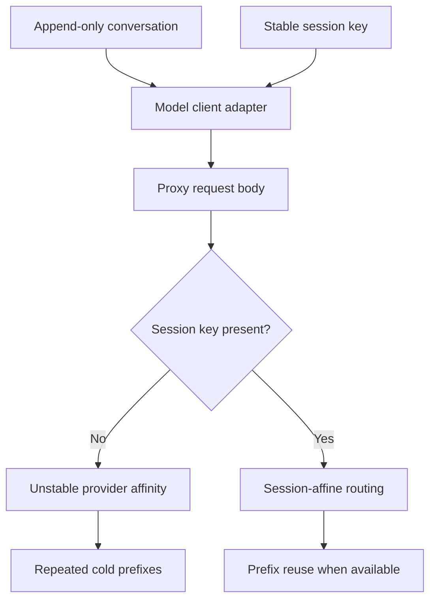

# The Session ID That Never Reached the LLM Proxy

We had a long-running agent whose conversation only ever grew at the end. The system prompt never changed. On paper, it was the ideal workload for prefix caching. In practice it was getting between zero and eight percent cache hits, and every turn paid for the whole conversation again.

After the fix, a full run of the same agent served about 91% of its prompt tokens from cache. The main agent and its evaluator cost nine cents together. The fix itself was a few lines. Finding where those lines belonged was the interesting part, so this post is mostly about how I narrowed it down.

## Two suspects

When an append-only conversation doesn't cache, there are really two ways it can happen:

1. **The prefix keeps changing.** Something like a timestamp, a reordered tool list, or an edited earlier message means the provider never sees the same bytes twice.
2. **The requests land on different replicas.** Our provider setup used session affinity to route a conversation back to the replica that already had its prefix cached. If that routing key goes missing, every request is effectively a cold start.

Both give you the same expensive bill. Only the first one is fixed by touching the prompt, so I wanted to rule it out before changing anything.



I fingerprinted the system prompt across turns and rebuilt the message sequence. The system content was byte-for-byte identical, and new turns were appended rather than spliced into the middle. That doesn't guarantee a cache hit, but it made "the prompt is changing" much less likely.

That left routing. Our parameter dictionary clearly had the session ID in it. For a while I took that as proof the routing was fine. It wasn't proof of anything, because I was looking in the wrong place.

## The dictionary is not the request

The question that mattered was what actually left the process, not what our code had built in memory.

So I pointed the client at a small local HTTP listener in place of the proxy and captured the raw request body. It had the model, the messages, and the output limit. Our top-level `metadata` wasn't there at all.

With the library version and proxy client route we were using, that field was dropped during serialization. Our code had set the value correctly, and the next layer down threw it away without a warning. When I checked from the proxy's side, the session key was missing there too.

That also explained why my earlier tweaks to the dictionary hadn't changed anything. The provider can't route on a key it never receives.

## The fix: use the field the adapter actually forwards

The adapter did pass `extra_body` through untouched, so I moved the session metadata there. This is simplified from the real parameter builder:

```python
extra_body = {
    **extra_body,
    "metadata": {
        **extra_body.get("metadata", {}),
        "session_id": cache_key,
    },
}
```

The nested merge is deliberate. If you overwrite `extra_body` you fix affinity and quietly delete some other provider option. If you overwrite `metadata` you can wipe another caller's attribution fields. Either would have shown up later as a confusing new bug.

I didn't take "the library accepts this keyword" as evidence either. I ran the capture again, confirmed the serialized body now carried the stable key, and only then tested against the real proxy.

## Proving it with a tiny experiment

Fleet-wide averages are a poor way to check a fix like this. They mix cold starts, unrelated conversations, and different routing paths together. So I built a three-request conversation that grew by one turn each time, where I knew exactly which bytes ought to be reused.

On the later requests the provider reported **154 of 174** prompt tokens cached, then **173 of 193**. The new suffix was uncached and almost all of the existing prefix was reused. That's the shape you'd expect.

There was one trap here. The proxy also had a response cache, which can return an old answer without calling the provider at all. When that happens, the provider's usage numbers stop telling you anything about prefix reuse. I used the route's cache-bypass controls so every request actually reached the provider. A response cache and a prefix cache are separate things, and it's easy to measure one when you meant the other.

## What it changed

| Run | Cached share of prompt tokens |
| --- | ---: |
| Control session, old path | ~5% |
| Full agent run, fixed path | ~91% |

The fixed run's main agent and evaluator cost **$0.09** in total. These are individual runs, not a controlled cost study, and a different conversation length or tool output will change the bill. What convinced me was the repaired request body and the predictable prefix reuse in the small experiment, more than the dollar figure.

## What I took away

The code change was small. The method is what I've kept using:

- Check that the prompt is stable before blaming the cache.
- Inspect the serialized request, not the object that produced it.
- Check what the receiving side actually saw.
- Compare usage call by call, not as an average.

If a setting looks right in code but has no effect downstream, look at the first representation the receiving system sees. Here a whole routing feature had silently turned into a no-op somewhere between a Python dict and an HTTP body, and logging the dict would never have shown it.
