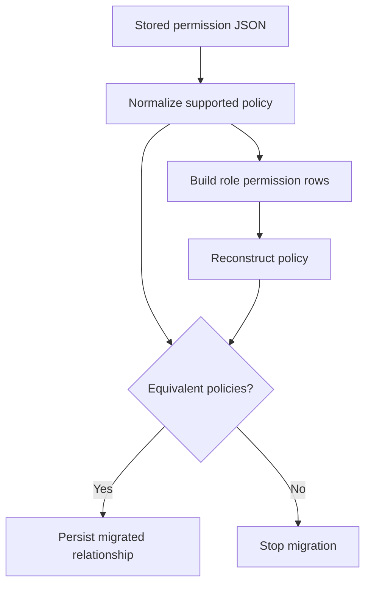

# Migrating Agent Permissions Without Granting Anything New

Our agent definitions kept their permissions inside a JSON configuration document. That was fine while a definition was the only thing anyone managed policy on. Role-backed permissions changed that. A definition would now reference a role, and the role would own rows describing each grant and denial.

The obvious migration was to parse the JSON and insert rows. That part was easy. The rest of the work came from one requirement: after the migration, **every agent must be able to do exactly what it could do before.** No new access and no lost restriction. Several JSON values carried meanings that a tidier relational schema could have erased without anyone noticing.

## Design the columns around the distinctions that matter

A permission wasn't always a resource name plus an allow flag. Tool rules could carry deny patterns or limits. Memory and skill access could be scoped. SQL permissions grouped tables by database. Path grants carried access levels.

Before designing a single column, I wrote down every distinction that had to survive the move:

| Distinction | Why collapsing it is dangerous |
| --- | --- |
| Missing policy versus empty grants | One may activate defaults; the other may allow nothing |
| Null scope versus an empty name | They can represent different resource selections |
| Exact tool name versus wildcard | They authorize different sets of future tools |
| Allow versus explicit deny | Dropping a deny can widen effective access |
| Stored order versus arbitrary row order | Reconstruction must not depend on database return order |

Each sentinel's meaning comes from the policy schema, not from what a database column conventionally means. `NULL` and `""` look interchangeable in a migration script, and in this policy they meant different things.

## One normalized form to compare against

The backfill turned a normalized policy into rows, rebuilt a policy from those rows, and refused to continue unless the two matched:



The core of it is short (the function names here describe the steps, not the real API):

```python
policy = normalize_permissions(stored_permissions)
rows = permissions_to_rows(policy)
restored = rows_to_permissions(rows)
assert restored == policy
```

That round-trip assertion catches omissions across every permission family at once, which row counts never would. It isn't enough on its own, though, because two converters can share the same bug. I added independent cases for wildcards, explicit denies, null versus empty scopes, SQL grouping, and ordering. Duplicates needed a deliberate decision too. Accepting duplicates in JSON and rejecting them as rows is a behavior change, even when the new constraint is the sensible one.

## The backfill wasn't the only writer

This is where a simple migration turns into a real project. Definitions could be edited through the management API, by agent tools, through imported bundles, through inherited configuration from a parent tenant, and through version restore. Some code paths also read the JSON directly, for example when exporting a definition or creating a session snapshot.

Moving only the main editor would have left two policy stores with different readers.

So I moved the write boundary itself. Updating the role, replacing its permission rows, and saving the rest of the definition all happen in one transaction. All reads go through a single reconstruction path that combines the row-backed permissions with the non-permission settings.

Version snapshots needed extra care. An old version of a definition must never be "completed" using the live role's current rows. If it were, exporting last month's version would silently include today's permissions.

## Staged schema change, visible deploy window

The new relationship went in as nullable, then got backfilled, then was constrained as required. Those are separate steps because a migration and an application rollout don't happen at the same instant. Old code can still be running after the new columns exist.

The legacy JSON stayed around temporarily to cover that window. It had a declared purpose and was always meant to go away. A second independently editable copy of policy can't be allowed to linger forever.

The migration also had to be replayable. Historical models skip today's save hooks, and conversion logic used by a migration shouldn't change whenever a live validator changes. That's one of the rare cases where a frozen copy of a helper is the right call and not just duplication.

## Rollback had a hidden data-loss path

Once the application starts editing permission rows, the old JSON is stale. A reverse migration that just drops the new relationship restores the schema and throws away every policy edit made since rollout. Depending on the edit, that could bring back an older, broader grant or quietly remove a restriction someone had just added.

So the reverse migration rebuilds the current permissions back into the legacy document before deleting anything relational. That only worked because I kept the policy vocabulary the same. If the new model had concepts the old one couldn't express, rollback would have needed an explicit limit instead.

## Storage changed, session policy didn't

Moving permissions into role rows doesn't mean running sessions should read the latest role on every turn. Sessions in this runtime keep a snapshot of their execution configuration. New sessions get the reconstructed policy in their snapshot, and existing sessions aren't rewritten just because storage moved.

The acceptance bar was about meaning, not cosmetics. The same definition reconstructs the same policy. Old versions stay old. A rollback keeps every edit made after rollout. A smaller JSON document was never evidence for any of them.
