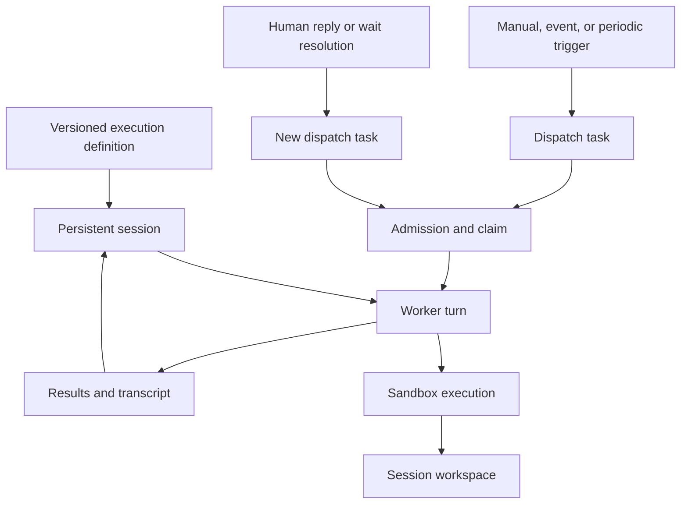

# What Must Survive When an Agent Worker Disappears?

Say a worker dies in the middle of an agent run. What does "retry" mean at that point?

It might mean claiming the job again. It might mean reloading a conversation that has been open for three weeks. Or it might mean reconnecting to the browser that agent was logged into, and that browser died with the pod.

Those are three different lifetimes. When I started on the agent runtime I work on, they were easy to blur behind a single "running" status. Most of the design work was separating them, so that every failure had a specific answer for what survived and what didn't.

## Three objects, and the fourth one I didn't build

The runtime has three durable things:

- **A definition** says what may run: instructions, resource references, permissions, budgets, and execution mode. A product owner edits definitions. A definition describes a kind of work, not one instance of it.
- **A session** is the conversation. It owns the inputs, results, workspace, transcript, and history. A human reads and replies to a session.
- **A task** is a short-lived scheduling handle. It gets work admitted, claimed, and dispatched, and then it's gone. It has no prompt and no state of its own.

On the first whiteboard sketch there was a fourth box, a "run" object for one invocation. I'm glad it never shipped. A run duplicates what the task already holds while work is queued and what the session holds once it's live. Persist it, and you have to keep it in sync with the session forever. Two statuses that both claim to say whether work is happening will eventually disagree, and every bug lives in that gap.

Every trigger goes through the same path: periodic, manual, event-driven, or a human replying to an old conversation. Create a task, then dispatch it.

Look at the bottom of the diagram: a new task can resume an existing session. When a workflow waits for a human, no Python function sits asleep holding a scheduler claim. The reply, or the timer, arrives later as a new event and goes through scheduling again like anything else.

When a finished session gets a new message, it's still the same session. I revive it instead of forking a fresh one. A fork would throw away the workspace and the trace, and those are what make the conversation debuggable.

## Snapshot the configuration at the start

A session records the execution configuration it started with. Without that, someone editing a definition could change a run halfway through, and you'd never be able to reproduce its result.

So edits to a definition don't cascade into existing sessions. New sessions pick up the new snapshot.

That doesn't mean revocation can wait until the next session. An emergency stop or a tenant access restriction needs its own explicit enforcement path. Quietly rewriting a historical snapshot isn't a substitute for designing that path.

Terminal states get the same care. A user stopping a run is *cancelled*. Running out of the duration budget is *paused*, which can be resumed, not *failed*. That distinction keeps on-call sane. An expensive agent that hits its budget is normal and shouldn't page anyone. A hard failure is a different signal.

## Shared files are not a shared process

A replacement worker can read a session's transcript and workspace. It can't bring back a browser's DOM, a shell's environment, an open connection, or a Python interpreter's heap.

That one distinction shapes the whole execution strategy:

| State | Can shared storage alone recover it? |
| --- | --- |
| Saved report or input file | Yes, if durably written |
| Conversation transcript | Yes, through the session loader |
| Browser login and live page | Not merely by mounting the same directory |
| Open REPL variables | No, unless separately checkpointed |

For computer-use and long-running agents, the bottom two rows are the ones that matter. So a session that needs a live environment gets pinned to one sandbox.

## Pinning a session to a sandbox

The obvious way to do that is a sticky load balancer. The trouble is that stickiness both sides can re-derive on the fly has no record to check against. The control plane and the worker can disagree about which pod is current. When they do, you end up debugging from a screenshot that no longer matches the page.

What worked for us instead has three stages.

**Admission before the session exists.** Placement is decided before the session row is created, because that's the only point where refusing is clean. Admission requires a verified, ready image and a ready worker pool with an observed worker identity. It returns a single binding: artifact, image digest, policy fingerprint, worker pool, and endpoint. If any piece is missing, the session isn't created. A half-configured box is worse than a failed create.

**A durable assignment.** Each session binding gets one assignment row recording the actual pod identity and endpoint. It moves through *pending*, *active*, *degraded*, and *released*, and it carries a lease owner, a lease generation, and an assignment generation. A released assignment is never reused, because handing a recycled pod to a new session is how one session ends up with another session's leftovers. In pooled mode, the least-occupied eligible pod wins, and pods whose egress policies don't match are never co-located. In dedicated mode, the pod must not already belong to another active session.

**Fail-closed routing.** Before a request reaches the sandbox, routing checks that the tenant, session, worker identity, and assignment generation all agree. A mismatch is an error. It never falls back to some other warm pod. That fallback would make the RPC succeed against an empty workspace or the wrong process, which is worse than failing.

Leases and generations solve different problems, and you need both. The lease limits who may reconcile an assignment right now. The generation lets the system reject a write from an owner whose lease has already been superseded, like a reconciler that paused for a while and woke up after a restart. Just recording an owner's name doesn't stop a delayed writer.

## Admission owns the concurrency decision

A request handler can report that capacity looks available. That's an observation, not a reservation. The real check belongs where capacity is actually claimed, inside the same transaction as the claim.

I learned that one the hard way. Checking a concurrency cap in the API and again in the worker, with two different queries, double-runs work under replicas. Each check passes on its own because each one reads a slightly stale count. The fix was to enforce the cap once, at the claim, under a row lock.

Periodic work follows the same rule. The dispatcher is deliberately boring. On each tick it asks to run every enabled schedule, and it keeps no "last ran at" state in memory. The database decides, under a lock on the schedule, whether a run is due, whether another run conflicts, and which trigger caused it. Two dispatchers can make the same suggestion, but only one gets through admission. Manual runs don't reset the automatic cadence. Otherwise an analyst testing a workflow would quietly push back the next scheduled run.

Admission doesn't solve delivery on its own, though. If the transaction commits and the process dies before enqueuing, the task is accepted but never delivered. Closing that gap takes a recoverable dispatch record or an outbox. "Accepted" and "delivered" are different states, and I keep them separate in the code.

## Recovery should answer a specific question

For a failed worker, I want to know whether the scheduling claim can be retried. For a resumed session, I want to know which transcript checkpoint was loaded. For a dead sandbox, I want to know which process state was lost.

A single reassuring "resumable" label hides all three. The architecture I'd build again is the one where every failure state tells an operator exactly what survived and exactly what has to start over.
